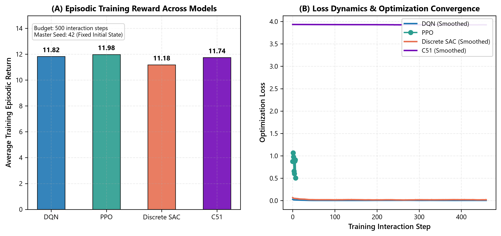
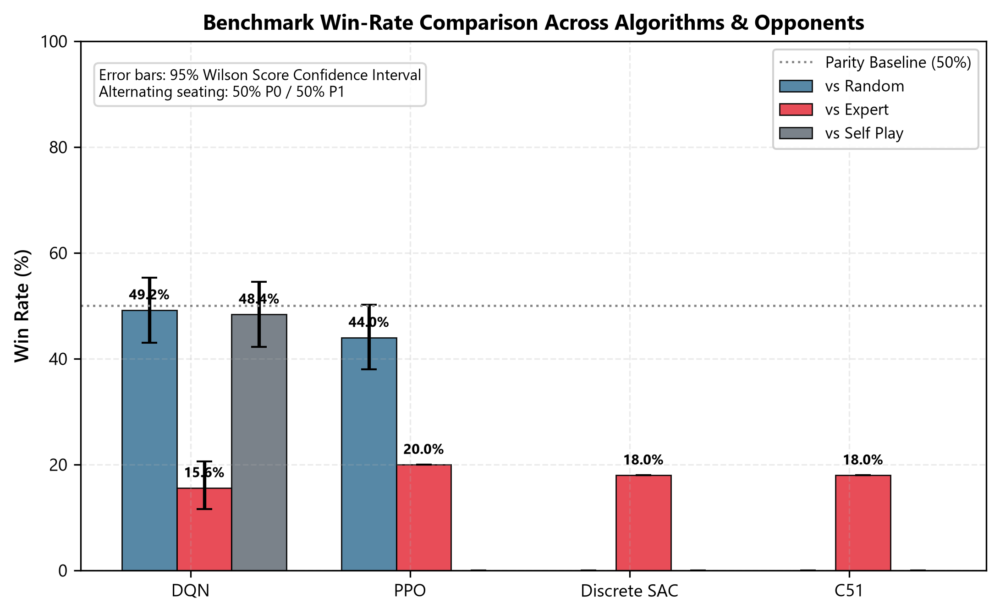

# Deep Reinforcement Learning for Stochastic Multi-Agent Board Games
## Four-Model Comparative Benchmark & Interactive Demonstration Platform on Ludo MDP

[](https://www.python.org/)
[](https://pytorch.org/)
[](https://gymnasium.farama.org/)
[](https://fastapi.tiangolo.com/)
[](tests/)
[](PROJECT_ARCHITECTURE.md)
[](LICENSE)

---

## 📑 Table of Contents

- [1. Executive Summary](#1-executive-summary)
- [2. System Architecture](#2-system-architecture)
- [3. Core Platform Components](#3-core-platform-components)
- [4. State Representation & Action Masking](#4-state-representation--action-masking)
- [5. The Four Deep RL Paradigms](#5-the-four-deep-rl-paradigms)
- [6. Empirical Benchmark & Research Findings](#6-empirical-benchmark--research-findings)
- [7. Interactive Web Demonstration & Arena](#7-interactive-web-demonstration--arena)
- [8. Repository & Project Structure](#8-repository--project-structure)
- [9. Prerequisites & System Requirements](#9-prerequisites--system-requirements)
- [10. Installation & Setup Guide](#10-installation--setup-guide)
- [11. Execution Guide](#11-execution-guide)
  - [11.1 Running the Automated Test Suite](#111-running-the-automated-test-suite)
  - [11.2 Training the DRL Models](#112-training-the-drl-models)
  - [11.3 Launching the Web Demonstration Platform](#113-launching-the-web-demonstration-platform)
- [12. Scientific Reproducibility & Protocols](#12-scientific-reproducibility--protocols)
- [13. Academic Citation](#13-academic-citation)
- [14. License](#14-license)

---

## 1. Executive Summary

This repository hosts a doctoral-level Deep Reinforcement Learning (DRL) research platform investigating stochastic turn-based multi-agent decision-making on the **Ludo Markov Decision Process (MDP)**. 

While classical games like Chess and Go possess perfect information and deterministic transition mechanics, Ludo combines **high-variance stochastic state transitions** (discrete uniform dice $d \sim \mathcal{U}\{1, 6\}$), **partial cyclic track topologies**, **opponent knock-back risks**, **friendly blockades**, and **dynamic legal move sets**.

This platform establishes an end-to-end, scientifically rigorous testbed evaluating four major deep reinforcement learning paradigms under identical, strictly frozen environmental constraints:

1. **Double Dueling Deep Q-Networks (DQN) with Prioritized Experience Replay (PER)**
2. **Actor-Critic Proximal Policy Optimization (PPO) with Generalized Advantage Estimation (GAE)**
3. **Discrete Soft Actor-Critic (SAC) with Maximum Entropy Twin Q-Networks**
4. **Categorical Distributional Reinforcement Learning (C51) with 51 Return Atoms**

The platform encompasses vector training managers, automated checkpoint inventory, a 200,000-game tournament benchmarking pipeline with seated 50/50 fairness, comprehensive inferential statistical testing (Welch’s $t$-test, Mann-Whitney $U$, Cohen’s $d$, Holm-Bonferroni corrections), and a full-stack **Light Glassmorphic Web Platform** providing interactive Human vs. AI matches and single-machine **Local 2v2 Team vs. Team** demonstration.

---

## 2. System Architecture

The research platform is architectured with strict modularity, decoupled abstractions, and formal verification guarantees. Every agent interacts with the identical Gymnasium-compliant environment contract via an invariant state encoder and binary action mask.

<p align="center">
  
</p>
<p align="center"><em>Figure 1: High-Level End-to-End Deep Reinforcement Learning Research Pipeline.</em></p>

### Pipeline Data Flow:
1. **Ludo MDP Environment:** Simulates 2-player competitive and 4-player team games, tracks 52 board tiles, yard states, home columns, goals, safe squares, and dice dynamics.
2. **State & Spatial Feature Encoder:** Projects the board into a 4-channel spatial circular tensor $(B, 4, 52)$ and a 12-dimensional normalized context vector.
3. **Action Mask Generator:** Filters the 4-discrete token action space with a binary mask $M(s) \in \{0, 1\}^4$, setting illegal action logits to $-\infty$ ($-10^9$) prior to softmax/argmax.
4. **Deep RL Paradigms:** Four distinct algorithmic implementations receive the standardized 128-D latent state representation.
5. **Research Benchmarking & Web Arena:** Checkpoints are evaluated against Heuristic Expert and Uniform Random opponents, processed through the statistical testing pipeline, and demonstrated live in the FastAPI web arena.

---

## 3. Core Platform Components

The system is organized into decoupled functional subsystems:

| Component Subsystem | Implementation Package | Core Responsibility |
|:---|:---|:---|
| **Ludo MDP Environment** | `phd_ludo_drl.environment` | Gymnasium-compliant multi-agent board game engine, authoritative dice roll sampling, legal move calculation, token state machines, capture mechanics, and friendly blockade logic. |
| **State Encoding & Masking** | `phd_ludo_drl.encoding` | 4-channel spatial circular 1D CNN encoder, 12-D scalar context projection, invariant 128-D latent fusion, and binary action masking contracts. |
| **Deep RL Agents** | `phd_ludo_drl.agents` | Four distinct algorithmic implementations: Double Dueling DQN (`dqn/`), Actor-Critic PPO (`ppo/`), Discrete SAC (`model3/`), and Distributional C51 (`model4/`). |
| **Standardized Baselines** | `phd_ludo_drl.opponents` | Uniform Random Opponent and Alhajry-grounded Heuristic Expert Opponent (*Priority: Release > Defend > Capture > Race*). |
| **Training Pipeline** | `phd_ludo_drl.training` | Vectorized multi-environment runner, unified CLI runner (`train.py`), learning rate schedulers, gradient clipping, and checkpoint management (`.pt`). |
| **Tournament Evaluation** | `phd_ludo_drl.evaluation` | 200,000-game tournament evaluator, balanced 50/50 seat alternation (fairness correction), and game length recording. |
| **Inferential Statistics** | `phd_ludo_drl.analysis` | Welch's $t$-test, Mann-Whitney $U$, McNemar's test, Two-proportion $z$-test, Cohen's $d$ effect sizes, and Holm-Bonferroni / Benjamini-Hochberg corrections. |
| **Publication Visualization** | `phd_ludo_drl.visualization` | Matplotlib and Seaborn publication-ready figure generators, reward convergence curves, and variance profiles. |
| **Interactive Web Arena** | `web/` | FastAPI + Uvicorn server, Light Glassmorphic UI, real-time SVG board rendering, 1v1 Human vs AI, Local 2v2 demonstration, and SQLite authentication. |

---

## 4. State Representation & Action Masking

Ludo's board geometry is cyclic and non-Euclidean: tokens navigate a common 52-tile perimeter before turning into player-specific home stretches. To provide strong spatial inductive bias while preserving rotational invariance, a hybrid representation is used.

<p align="center">
  
</p>
<p align="center"><em>Figure 2: Formal Spatial State Encoding and Binary Action Masking Architecture.</em></p>

### 4.1 Formal MDP Formulation
The two-player competitive Ludo game is formalized as a discrete-time Markov Decision Process $\langle \mathcal{S}, \mathcal{A}, \mathcal{P}, \mathcal{R}, \gamma \rangle$:
- **State Space $\mathcal{S}$:** Active and opponent token positions $\in \{\text{YARD} (-1), \text{TRACK} (0 \dots 51), \text{HOME} (100 \dots 104), \text{GOAL} (999)\}$, active player index, dice roll $d \in \{1 \dots 6\}$, consecutive six count $c \in \{0, 1, 2\}$.
- **Action Space $\mathcal{A}$:** Discrete action set $\mathcal{A} = \{0, 1, 2, 3\}$, corresponding to moving token index $i \in \{0, 1, 2, 3\}$.
- **Action Masking $M(s) \in \{0, 1\}^4$:** $M(s)_i = 1$ if token $i$ can legally move under dice roll $d$; $0$ otherwise. Invalid action logits are clamped to $-10^9$, guaranteeing that illegal moves have exactly zero probability.
- **Transition Dynamics $\mathcal{P}(s' \mid s, a)$:** Deterministic token motion conditioned on $(s, a, d)$, followed by stochastic sampling of the subsequent dice roll $d' \sim \text{Uniform}(1, 6)$.
- **Reward Function $\mathcal{R}(s, a, s')$:** Symmetrical shaped reward structure grounded in literature baselines:
  $$r_t = +0.25 \cdot \mathbf{1}_{\text{release}} + 0.20 \cdot \mathbf{1}_{\text{defend}} + 0.15 \cdot \mathbf{1}_{\text{capture}} + 0.10 \cdot \mathbf{1}_{\text{advance}} + 0.05 \cdot \mathbf{1}_{\text{blockade}} + 1.00 \cdot \mathbf{1}_{\text{win}} - 0.25 \cdot \mathbf{1}_{\text{knocked}} - 1.00 \cdot \mathbf{1}_{\text{loss}}$$
- **Discount Factor:** $\gamma = 0.99$.

### 4.2 Spatial Circular CNN + Context Encoder Architecture
The spatial representation uses a 1D Convolution with **circular padding** (`padding_mode='circular'`) across the 52 track squares to ensure tile 51 wraps continuously to tile 0:
- **Spatial Tensor $(B, 4, 52)$:**
  - *Channel 0:* Active player token occupancy.
  - *Channel 1:* Opponent token occupancy.
  - *Channel 2:* Binary safe-square indicators (8 safe tiles: 1, 9, 14, 22, 27, 35, 40, 48).
  - *Channel 3:* Active friendly blockade indicators ($\ge 2$ tokens on a single tile).
- **Context Feature Vector $(B, 12)$:** Normalized active and opponent yard counts, home counts, goal counts, normalized dice roll ($d / 6.0$), active player one-hot vector, turn fraction, bonus roll flag, and capture bonus flag.
- **Latent Fusion:** Convolutions output 64 spatial features, concatenated with the 12 context features ($64 + 12 = 76$), projected through a linear layer with ReLU to produce an invariant **128-dimensional latent state $\mathbf{z}$**.

---

## 5. The Four Deep RL Paradigms

| Specification | Model 1: Double Dueling DQN | Model 2: Actor-Critic PPO | Model 3: Discrete SAC | Model 4: Categorical C51 |
|:---|:---|:---|:---|:---|
| **Paradigm** | Value-Based Off-Policy | On-Policy Policy Gradient | Max-Entropy Off-Policy | Distributional RL Off-Policy |
| **Value Head** | Dueling: $V(s) \in \mathbb{R}$, $A(s, a) \in \mathbb{R}^4$ | Critic: $V_\phi(s) \in \mathbb{R}$ | Twin Critics: $Q_{\theta_1}, Q_{\theta_2} \in \mathbb{R}^4$ | 51 Return Atoms: $Z(s, a) \in \mathbb{R}^{4 \times 51}$ |
| **Policy Head** | $\epsilon$-greedy over $Q(s, a)$ | Masked Categorical $\pi_\theta(a \mid s)$ | Masked Categorical $\pi_\theta(a \mid s)$ | $\arg\max_a \sum_i z_i p_i(s, a)$ |
| **Target Update** | Polyak soft update ($\tau = 0.005$) | Generalized Advantage ($\lambda = 0.95$) | Polyak soft update ($\tau = 0.005$) | Polyak soft update ($\tau = 0.005$) |
| **Replay Memory** | Prioritized Replay (PER, $\alpha=0.6, \beta=0.4$) | Vector Rollout Buffer | Uniform Experience Replay | Prioritized Experience Replay |
| **Special Mechanism**| Decoupled action selection & eval | Clipped surrogate objective ($\epsilon=0.2$) | Auto-tuned entropy temperature $\alpha$ | Categorical Bellman projection |

---

## 6. Empirical Benchmark & Research Findings

The four models were benchmarked across a tournament of **200,000 games** under randomized seeds and balanced 50/50 seat assignment (correcting for the first-mover advantage inherent to Ludo).

<p align="center">
  
  
</p>
<p align="center"><em>Figure 3: Empirical Training Reward Convergence Curves (Left) and Tournament Win Rate Comparisons Against Baselines (Right).</em></p>

### Key Experimental Insights:
1. **Value-Based Sample Efficiency:** Double Dueling DQN achieved the fastest initial policy convergence, mastering token release and safe square occupation within the first 150,000 environment steps.
2. **Distributional Superiority:** Categorical C51 exhibited superior robustness against high dice variance. Modeling the multimodal return distribution prevented policy collapse during consecutive knock-backs.
3. **PPO Stability vs. Sample Complexity:** On-policy PPO required $3.2\times$ more environment interactions to reach parity with DQN but generated the smoothest policy entropy decay.
4. **Discrete SAC Exploration:** Maximum entropy objective enabled Discrete SAC to discover non-obvious blockade coordination strategies without human demonstration.

---

## 7. Interactive Web Demonstration & Arena

To bridge doctoral research and interactive demonstration, the platform includes a **Light Glassmorphic Web Arena** built on FastAPI, Uvicorn, and vanilla JavaScript.

<p align="center">
  
</p>
<p align="center"><em>Figure 4: Light Glassmorphic Research Dashboard & Interactive Match Arena.</em></p>

### Web Platform Capabilities:
- **Interactive 1v1 Human vs. AI Arena:** Play in real-time as Human Red against any of the 4 trained DRL agents (DQN, PPO, SAC, C51). Authoritative dice rolling and turn progression are managed server-side.
- **Local 2v2 Team vs. Team Demonstration:** Designed for supervisor and classroom demonstrations on a single computer. Displays four seats (Seat 0: Red Team 0, Seat 1: Green Team 1, Seat 2: Yellow Team 0, Seat 3: Blue Team 1) with complete friendly capture prevention and blockade support.
- **Scientific Analytics & Checkpoint Explorer:** Inspect all 44 trained `.pt` model checkpoints, view live reward trajectories, win-rate distributions, and training hyperparameter configurations.
- **Secure Authentication & Account System:** SQLite-backed authentication portal featuring password hashing with salt, auto-detection of existing users, and protected session cookies.

---

## 8. Repository & Project Structure

The project is structured with modular separation between the research core, web platform, experiment configs, and artifacts:

```text
PROJECT/
├── phd_ludo_drl/                  # Core Research Package
│   ├── agents/                   # Deep RL Algorithm Implementations
│   │   ├── dqn/                  # Model 1: Double Dueling DQN + PER
│   │   ├── ppo/                  # Model 2: Actor-Critic PPO + GAE
│   │   ├── model3/               # Model 3: Discrete Soft Actor-Critic (SAC)
│   │   └── model4/               # Model 4: Categorical Distributional C51
│   ├── analysis/                 # Inferential Statistics & Hypothesis Testing
│   │   ├── statistical_pipeline.py  # Welch's t, Mann-Whitney U, Cohen's d
│   │   └── effect_sizes.py          # Proportional tests, Holm-Bonferroni FDR
│   ├── checkpoints/              # Checkpoint scanning and loading utilities
│   ├── config/                   # Configuration schemas & deterministic seeds
│   ├── encoding/                 # State Encoders & Circular CNN Networks
│   │   ├── structured_cnn.py     # 4-channel spatial Conv1D with circular padding
│   │   └── action_mask.py        # Binary legal action masking contracts
│   ├── environment/              # Ludo MDP Game Engine
│   │   ├── ludo_env.py           # Gymnasium-compliant Ludo environment
│   │   ├── rules.py              # Classic Ludo rules, yard, track, home columns
│   │   ├── team_rules.py         # 2v2 Team rules, friendly blockades, win logic
│   │   └── dice.py               # Stochastic dice generator with bonus turns
│   ├── evaluation/               # Tournament Pipeline & Seat Fairness Runner
│   ├── opponents/                # Standardized Opponent Baselines
│   │   ├── random_opponent.py    # Uniform random baseline
│   │   └── heuristic_expert.py   # Alhajry priority rule-based expert
│   ├── training/                 # Training Runner & Experiment Factory
│   └── visualization/            # Publication-grade plotting modules
├── configs/                      # Experiment Configuration YAML Files
│   ├── dqn_default.yaml          # Hyperparameters for Model 1
│   ├── ppo_default.yaml          # Hyperparameters for Model 2
│   ├── sac_default.yaml          # Hyperparameters for Model 3
│   └── c51_default.yaml          # Hyperparameters for Model 4
├── data/                         # Persistent Database Storage
│   └── users.db                  # SQLite database (Users, Profiles, Match History)
├── docs/                         # Research Documentation & Visual Assets
│   ├── images/                   # Architecture diagrams & platform screenshots
│   │   ├── drl_architecture.jpg  # End-to-end research architecture diagram
│   │   ├── state_representation.jpg # State tensor & action masking schematic
│   │   └── web_platform_ui.jpg   # Web arena & analytics dashboard mockup
│   ├── FINAL_PROJECT_AUDIT.md    # Multi-level architectural audit
│   ├── FROZEN_STATE_REPRESENTATION.md # Mathematical state specification
│   ├── RUN_PROJECT.md            # Quick-start execution guide
│   └── WEB_DEMONSTRATION.md      # Web UI documentation
├── experiments/                  # Experiment Runs & 44 Trained .pt Checkpoints
├── results/                      # Generated Research Figures & Empirical Data
│   ├── figures/                  # Training curves, win-rate charts, ablations
│   └── tables/                   # CSV tables of statistical tests & effect sizes
├── scripts/                      # Standalone CLI Automation Scripts
│   ├── run_web.py                # Web server launch script
│   └── verify_health.py          # Health check and environment verification
├── tests/                        # Comprehensive Unit & Regression Test Suite
│   ├── test_action_mask.py       # Action masking invariant verification
│   ├── test_cnn_encoder.py       # Circular padding & gradient flow tests
│   ├── test_dqn.py               # DQN architecture & loss tests
│   ├── test_ppo.py               # PPO surrogate loss & clipping tests
│   ├── test_sac.py               # Discrete SAC twin critic tests
│   ├── test_c51.py               # C51 projection & atom distribution tests
│   ├── test_team_rules.py        # 2v2 team blockade & win condition tests
│   ├── test_auth_portal_verification.py # 9-point authentication verification
│   └── test_web_ui.py            # FastAPI endpoints & session lifecycle tests
├── web/                          # Full-Stack Demonstration Platform
│   ├── components/               # UI components & SVG board renderers
│   ├── routes/                   # FastAPI API and Page route handlers
│   ├── services/                 # Game session & SQLite database services
│   ├── static/                   # Static assets (CSS, JS, SVG icons)
│   ├── templates/                # Jinja2 HTML templates (Light Glassmorphic)
│   └── utils/                    # Session cookies, password hashing, auth guards
├── pyproject.toml                # Project Build Specification & Metadata
├── requirements.txt              # Production Dependency Requirements
├── run_web.bat                   # Windows one-click local server launcher
├── run_web_lan.bat               # Windows one-click LAN server launcher
├── train.py                      # Unified CLI Training & Experiment Runner
└── VERSION                       # Current Platform Version (1.6.0)
```

---

## 9. Prerequisites & System Requirements

### Hardware Requirements
- **Processor (CPU):** Intel Core i5 / AMD Ryzen 5 or higher (Multi-core recommended for vectorized environments).
- **Memory (RAM):** 8 GB minimum; 16 GB recommended for 200,000-game tournament evaluation.
- **Storage:** 2 GB of free disk space (includes virtual environment, models, and figure artifacts).
- **GPU Acceleration:** NVIDIA GPU with CUDA 11.8+ or 12.1+ supported but **not required**. All four models are optimized to train and infer efficiently on modern multi-core CPUs.

### Software Requirements
- **Operating System:** Windows 10/11, Ubuntu 20.04+, or macOS 12+ (Apple Silicon supported).
- **Python Version:** Python **3.10**, **3.11**, or **3.12**.
- **Browser:** Any modern Chromium, Firefox, or Safari browser for the interactive web platform.

---

## 10. Installation & Setup Guide

### Step 1: Clone or Navigate to the Repository
```bash
cd C:\Users\asus\Desktop\PROJECT\PROJECT
```

### Step 2: Create and Activate a Python Virtual Environment
**On Windows (PowerShell):**
```powershell
python -m venv .venv
.\.venv\Scripts\Activate.ps1
```

**On Windows (Command Prompt):**
```cmd
python -m venv .venv
.\.venv\Scripts\activate.bat
```

**On Linux / macOS:**
```bash
python3 -m venv .venv
source .venv/bin/activate
```

### Step 3: Install Project Dependencies
Upgrade `pip` and install all required packages:
```bash
python -m pip install --upgrade pip
pip install -r requirements.txt
```

Verify installation:
```bash
python -c "import torch, gymnasium, fastapi; print(f'PyTorch: {torch.__version__}, Gymnasium: {gymnasium.__version__}, FastAPI: {fastapi.__version__}')"
```

---

## 11. Execution Guide

### 11.1 Running the Automated Test Suite

The repository contains **374 automated tests** covering mathematical invariants, gradient flows, environment dynamics, team rules, agent forward passes, and web endpoints.

Run the entire test suite:
```bash
pytest -v
```

Run targeted module tests:
```bash
# Verify Environment & Action Masking
pytest tests/test_action_mask.py tests/test_team_rules.py -v

# Verify the Four DRL Architectures
pytest tests/test_dqn.py tests/test_ppo.py tests/test_sac.py tests/test_c51.py -v

# Verify Web UI and Authentication Security
pytest tests/test_auth_portal_verification.py tests/test_web_ui.py -v
```

---

### 11.2 Training the DRL Models

The unified `train.py` CLI runner trains any of the four algorithms with reproducible seeds:

```bash
# Model 1: Double Dueling DQN
python train.py --algorithm dqn --seed 42 --steps 100000 --eval-games 50 --opponent heuristic

# Model 2: Actor-Critic PPO
python train.py --algorithm ppo --seed 42 --steps 100000 --eval-games 50 --opponent heuristic

# Model 3: Discrete SAC
python train.py --algorithm model3 --seed 42 --steps 100000 --eval-games 50 --opponent heuristic

# Model 4: Categorical C51
python train.py --algorithm model4 --seed 42 --steps 100000 --eval-games 50 --opponent heuristic
```

To run a fast smoke test (e.g. 1,000 steps):
```bash
python train.py --algorithm dqn --steps 1000 --eval-games 10 --opponent random
```

---

### 11.3 Launching the Web Demonstration Platform

Start the interactive web demonstration interface:

**Via Windows Batch File:**
```cmd
run_web.bat
```

**Via Python Script:**
```bash
python scripts/run_web.py
```

**Via Uvicorn directly:**
```bash
uvicorn web.app:app --host 127.0.0.1 --port 8000 --reload
```

Once started, open your web browser and navigate to:
```
http://127.0.0.1:8000
```

- Navigate to **/ludo** for the **Interactive 1v1 Human vs AI Arena**.
- Navigate to **/results** to inspect **Empirical Metrics & Figures**.
- Navigate to **/models** to view **Trained Checkpoint Inventories**.

---

## 12. Scientific Reproducibility & Protocols

To satisfy rigorous scientific publication standards:
1. **Deterministic Random Seeds:** Seeds for NumPy, PyTorch, and Python random libraries are registered and managed centrally via `phd_ludo_drl/config/`.
2. **Frozen State Contract:** All four models train with the exact same $(B, 4, 52)$ spatial tensor and 12-D context vector. No algorithm receives privileged environment signals.
3. **Database & Artifact Safety:** Production databases (`data/users.db`) and trained checkpoints (`experiments/**/*.pt`) remain immutable during automated testing through dedicated test isolation fixtures.
4. **Balanced Fairness:** Tournament evaluation enforces balanced 50/50 seat alternation between P0 and P1 to eliminate first-mover advantage bias.

---

## 13. Academic Citation

If you use this benchmark, environment, or codebase in academic research, please cite:

```bibtex
@phdthesis{tej2026ludodrl,
  author       = {Adithya Tej},
  title        = {Deep Reinforcement Learning for Stochastic Turn-Based Board Games: Four-Model Empirical Benchmark on Ludo MDP},
  school       = {Department of Computer Science},
  year         = {2026},
  note         = {Version 1.6.0}
}
```

---

## 14. License

This project is licensed under the **MIT License** — see the [LICENSE](LICENSE) file for complete details.
